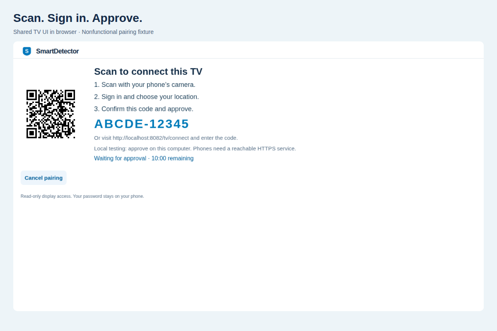
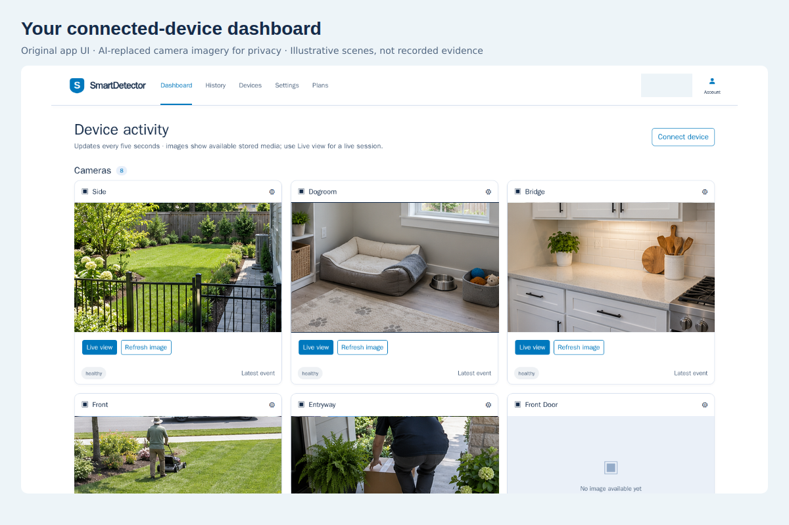

```text
 SSSS M   M   A   RRRR  TTTTT DDDD  EEEEE TTTTT EEEEE  CCCC TTTTT  OOO  RRRR
S     MM MM  A A  R   R   T   D   D E       T   E     C       T   O   O R   R
 SSS  M M M AAAAA RRRR    T   D   D EEEE    T   EEEE  C       T   O   O RRRR
    S M   M A   A R R     T   D   D E       T   E     C       T   O   O R R
SSSS  M   M A   A R  RR   T   DDDD  EEEEE   T   EEEEE  CCCC   T    OOO  R  RR

CONNECTED SIGNALS. CLEAR INCIDENTS. FASTER RESPONSE.
```

# SmartDetector

### Your devices. One perspective.

[](https://github.com/techcto/smartdetector/actions/workflows/ci.yml)
[](https://github.com/techcto/smartdetector)

**A native Vega TV experience that turns connected-camera events into something you can browse, understand and review from your couch.**

[Start the judge walkthrough](docs/HACKATHON-FIELD-GUIDE.md) · [Technical README](README-TECHNICAL.md) · [AWS architecture](docs/AWS-ARCHITECTURE.md) · [Download latest Vega app](https://github.com/techcto/smartdetector/releases/latest/download/smartdetectorconsole_armv7.vpkg)

<a href="https://smartdetector.com"></a>

## A name waiting for the right idea

I’ve owned **smartdetector.com** for a few years. Originally, I wanted to build a smarter smoke detector—and I still do. Before this hackathon, though, SmartDetector was just the name and an idea. **The SmartDetector project was built entirely during the hackathon.**

Ring’s cameras and device APIs gave that idea a practical starting point: real-world activity we could bring into one connected experience. Instead of another isolated dashboard, we wanted one perspective across the devices around us.

Our long-term vision goes beyond cameras: more smart devices, more useful context, and eventually dedicated SmartDetector hardware. This first version starts with the moments your cameras already capture.

## Why Fire TV? Why Vega?

We chose the **Fire TV track** of the [Build, Ship, Shape hackathon](https://amazonappdev2026.devpost.com/) to build with the new **Vega OS and React Native**. We wanted checking your home to feel as natural as browsing your favorite shows.

Inspired by Ring and Prime Video, SmartDetector treats cameras like collections and events like episodes. Use your remote to browse a camera, select a moment, and inspect its sampled images and available observations.

**Ring supplies the activity. SmartDetector organizes it. Vega brings it to your screen.**


*UI captured on a physical Vega Fire TV. Camera imagery is replaced with similar AI-generated scenes for privacy; the interface is unchanged.*

[Watch the browser UI walkthrough](docs/images/vega-playwright/1280-walkthrough.webm) · [Native capture details](docs/images/vega-native/README.md)

## From a moment at the door to a clearer picture

1. **Connect your cameras.** Authorize Ring access and choose the location and cameras you want to share.
2. **Pair your TV.** Scan a QR code, sign in on your phone, and approve the display. No password or API key goes on the TV.
3. **Browse what happened.** Open camera and activity rails, history, and saved-event search using remote-friendly navigation.
4. **Review the evidence.** Step through sampled frames and inspect available detections and AI context.
5. **Stay in control.** Use location-scoped access, revocable read-only displays, data purge and account deletion. Saved event/image retention defaults to 24 hours.



*Playwright capture of the pairing interface. The displayed code is a nonfunctional fixture; use the code on your own running app.*



*The same connected-device dashboard on the web, with similar AI-generated camera scenes substituted for privacy.*

[View the complete screenshot gallery](docs/demo-assets/gallery/README.md)

The app also includes foreground alerts. An ADM background receiver and actionable system-popup integration are implemented; cross-app popup/image behavior remains a physical-device verification item. Native live video is not implemented: live-view links use the web console. We keep those boundaries explicit rather than presenting planned capabilities as finished features.

## AWS behind the screen


The hosted **[SmartDetector website](https://smartdetector.com)** manages accounts, locations, device connections and incident history. The native TV is a paired, read-only viewer of the same retained evidence.

The backend uses **ECS/Fargate, DynamoDB, SQS, optional EventBridge, S3, IAM and CloudFormation**. SmartDetector’s own **Amazon Bedrock** integration summarizes supplied incident observations using the configured model and the installation’s AWS permissions. Configured delivery integrations include SES email and ADM for background TV alerts.

**Optional detection add-on:** AutoVision is a separately developed external service, outside this hackathon submission. SmartDetector’s integration is free to add and can provide additional visual detection features when configured. External hosting, inference costs and usage limits are separate. AutoVision’s implementation and features are not claimed as SmartDetector hackathon work.

Measurements and AI observations remain distinct. A label is not proof of identity, intent or danger; SmartDetector is not a certified emergency alarm.

We documented the service choices, alternatives and configuration boundaries in the **[AWS architecture guide](docs/AWS-ARCHITECTURE.md)**.

## Open source, including an agent integration

We are also submitting for the **AWS Builder** and **Open Source** mini challenges. The AWS guide explains the backend; the separate **[SmartDetector MCP / AgentCore integration](https://github.com/techcto/smartdetector-agentcore)** provides scoped access to SmartDetector’s REST API for agent clients, including a deployment path for AWS AgentCore.

Its five tools are **read-only**: agents can inspect devices and events, not control cameras or change incidents. Local verification and deployable templates are separate from proof of a running AWS AgentCore invocation. See the [technical reference](README-TECHNICAL.md#mcp-and-amazon-bedrock-agentcore) for setup and security boundaries.

## Try it yourself

**Judges: [follow the illustrated field guide](docs/HACKATHON-FIELD-GUIDE.md).** It starts at simulator installation, then walks through free SmartDetector signup, TV approval, Ring staging access, and the no-camera developer route. You do not need to buy a SmartDetector plan for the basic walkthrough; contact us if quotas block evaluation.

- **Have a Vega Fire TV?** [Download the latest ARMv7 app](https://github.com/techcto/smartdetector/releases/latest/download/smartdetectorconsole_armv7.vpkg) and install it using the field guide. [Release details and checksum](https://github.com/techcto/smartdetector/releases/latest). Until the first public app release is published, the [v0.1.18 workflow download](https://github.com/techcto/smartdetector/actions/runs/39792550577/artifacts/12433155518) remains available with GitHub sign-in.
- **Using the simulator?** Follow the guide’s x86_64 build instructions; the physical-TV package is not the simulator package.
- **No Ring camera?** Use the documented localhost Ring Playground path. Sample-stream analysis shares the processing pipeline but is not a production motion-webhook test.
- **Building or deploying?** Open the [technical README](README-TECHNICAL.md), [Ubuntu setup](docs/ubuntu-tv-development.md), or [CloudFormation guide](devops/cloudformation/README.md).

## What we learned—and what’s next

A new device platform brings real learning: runtime differences, notifications, device pairing, simulator setup and release packaging. Our **[developer friction report](docs/friction-log.md)** records the observed issues, workarounds and actionable suggestions, including the successful headless release build.

Next, we want broader device integrations, more useful and carefully evaluated AI, and native mobile companions that work alongside Fire TV. Platform improvements we would welcome include consistent notifications across supported React Native versions, a complete background-delivery sample, and Ring Playground scenarios that deliver signed motion webhooks as well as sample video.

**SmartDetector started with a name. This hackathon gave it a working native TV experience—and a foundation for bringing connected devices into one perspective.**

## Explore further

[Judge field guide](docs/HACKATHON-FIELD-GUIDE.md) · [Technical README](README-TECHNICAL.md) · [AWS choices](docs/AWS-ARCHITECTURE.md) · [Friction report](docs/friction-log.md) · [Privacy policy](https://smartdetector.com/privacy) · [Support](mailto:help@solodev.com)

First-party code is [AGPL-3.0-or-later](LICENSE). Third-party components retain their licenses. Contact [support](mailto:help@solodev.com) about separate terms for maintainer-owned code.
