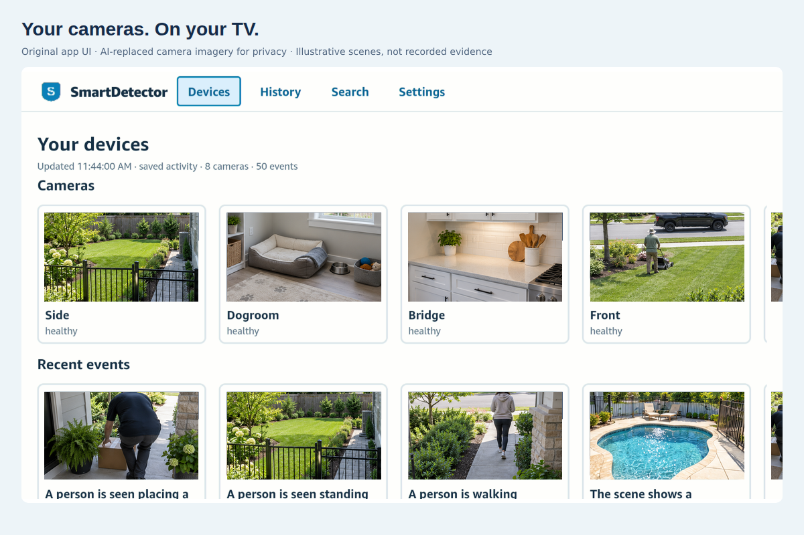

# SmartDetector Console for Vega



*Physical-TV interface with similar AI-generated camera imagery for privacy. UI pixels are preserved; photos are illustrative, not recorded evidence.*

[Screenshot gallery](../../docs/demo-assets/gallery/README.md) · [Judge’s field guide](../../docs/HACKATHON-FIELD-GUIDE.md)

Integration scope: SmartDetector’s own Bedrock feature summarizes incident observations. AutoVision, where mentioned below, is an optional, separately developed external detection add-on outside this hackathon submission. Its connector is free to add; external service configuration, quotas and costs still apply. Steps that invoke that add-on require it and are not evidence of native SmartDetector image detection.

Native React Native client, separate from the Next.js web console. Uses the Amazon SDK's React Native 0.72 `helloWorld-rn72` template, not a WebView or Android APK.

Implemented source: short-lived pairing, location-scoped read-only feed, device browsing, event/frame review with detection overlays, saved-event text search, foreground alerts, remote focus and Back navigation. Fire TV displays are excluded from camera browsing. Data purged on the server disappears on refresh. The shared screens include a responsive phone layout with full-width cards, wrapped controls and narrower spacing.

Native compilation and packaging have succeeded locally for ARMv7, x86_64 and aarch64. ARMv7 installation and production pairing have been observed on a physical Vega TV. Native Ring live video, direct remote microphone access and persistent secure token storage are not implemented. The RN 0.72 build implements ADM background receiving and an actionable system toast; live delivery and image presentation over another app remain unverified. Tokens are memory-only: pair again after restarting. Local disconnect clears memory; revoke the display through Devices → Fire TV on the website. Native image caching behavior still needs device privacy validation.

## Build and test

For background notification setup and verification, see [TV notifications](../../docs/tv-notifications.md). The standard app uses RN 0.72; there is no alternate app. Background alerts over other apps still require physical verification.

Start with [Ubuntu local development](../../docs/ubuntu-tv-development.md) for the complete backend, browser preview, Vega, QR approval and Fast Refresh setup. Debug automatically uses localhost; Release automatically uses the production site.

1. Install [Amazon Vega SDK 0.24 / Vega Studio](https://developer.amazon.com/docs/vega/0.24/install-vega-sdk). Use its supported Node/toolchain environment and React Native 0.72 template.
2. From the repository root run `npm --prefix apps/vega test`, then `npm --prefix apps/vega run build:app`.
3. The preparation script generates the official template in `.generated/project`, validates its runtime assumptions and overlays this client's source. Runtime definitions remain SDK-owned; app branding, package version and Metro's `.mjs` extension support are configured by the preparation script. If the template changes, it fails for review. Generated files are disposable; do not edit them as source.
4. For a tagged build set `SMARTDETECTOR_RELEASE_VERSION` to the tag without `v`. `SMARTDETECTOR_VEGA_BUILD_NUMBER` supplies a positive build number; releases use the GitHub workflow run number, while local builds default to 1. For a reachable development backend set `SMARTDETECTOR_VEGA_DEV_ORIGIN` to your HTTPS test origin. Debug defaults to loopback HTTP; Release defaults to https://smartdetector.com and requires HTTPS for custom deployment origins. Embedded credentials and remote HTTP are rejected. No app secrets belong in this build. The manifest declares Amazon's optional virtual-keyboard service for text search.
5. Use the SDK simulator first. For the Fire TV Stick 4K 3rd Gen (Vega OS 2.0, 32-bit), use the **ARMv7 `.vpkg`**, not an APK or simulator package.

Follow [Amazon's device testing instructions](https://developer.amazon.com/docs/vega/0.24/run-apps): enable Developer Mode and complete CLI developer-account authentication, then `vega device list` and `vega device install-app --packagePath <armv7-package.vpkg>`. Launch using the component ID in the generated manifest/app.json. Consumer unknown-source restrictions are distinct from this developer workflow. Configure Vega Studio's development server port away from 8081 if AutoVision is using that port.

On TV choose Get pairing code. On your phone open `https://smartdetector.com/tv/connect`, sign in, select the correct location and approve the display. Validate revocation, location isolation, purge refresh, network failures, foreground/background behavior, frame overlays and every Back transition on real hardware before submission. Search uses retained structured event evidence, not arbitrary full-video semantic indexing.

## Release management

Judge mode is a Release build pointed at **https://smartdetector.com**, on both emulator and physical TV. With the SDK installed, `bash apps/vega/scripts/judge-emulator.sh` downloads and verifies the latest x86_64 package, boots the emulator and launches the app. No Docker, Metro or localhost service is required. Debug/local development remains an explicit separate workflow.

The release packaging matrix builds **ARMv7 and x86_64 in parallel** from the same revision. Publication waits for both. Download [x86_64 for the emulator](https://github.com/techcto/smartdetector/releases/latest/download/smartdetectorconsole_x86_64.vpkg) or [ARMv7 for a supported Fire TV](https://github.com/techcto/smartdetector/releases/latest/download/smartdetectorconsole_armv7.vpkg); checksums cover both. Set `SMARTDETECTOR_VEGA_TARGET=x86_64` for a local Docker emulator build; the builder defaults to ARMv7. Existing ARMv7-only releases will not acquire an emulator package until a new dual-target release is published.

For either judge package, create a free account at [smartdetector.com/signup](https://smartdetector.com/signup), then approve the displayed code at [smartdetector.com/tv/connect](https://smartdetector.com/tv/connect). No paid SmartDetector plan is needed for basic testing. Connected cameras, retained media and configured analysis quotas still determine what evidence is available.

Successful stable version-tag builds publish a public GitHub Release only after packaging and artifact upload succeed. Assets are uploaded to a draft before publication; existing published versions are not overwritten. The stable download is [latest ARMv7 app](https://github.com/techcto/smartdetector/releases/latest/download/smartdetectorconsole_armv7.vpkg), with checksum and SDK/audit evidence on the [release page](https://github.com/techcto/smartdetector/releases/latest). GitHub selects latest using stable release metadata/version ordering; prerelease tags and manual non-tag builds do not promote it. This uses GitHub’s latest-release URL, not a mutable Git tag or container tag. It becomes available after the first successful publication job. Public release downloads do not require Actions-artifact sign-in and are separate from the 90-day workflow artifacts.

Every normal CI run tests the dependency-free client logic. `release-vega.yml` runs on version tags and publishes a **source archive** workflow artifact independently of ECS/AWS Marketplace releases. This is not an installable app.

Package jobs build a version-pinned SDK Docker image on GitHub-hosted Ubuntu runners, then run client tests and package compilation inside it. Tag releases and manual releases build and retain both ARMv7 and x86_64 `.vpkg` workflow artifacts for 90 days; missing output fails the corresponding job. No self-hosted runner or repository opt-in variable is required. Amazon Appstore submission remains manual and separate from AWS Marketplace container delivery. Capture the SDK version, package checksum and device test results with each submitted build.

## Docker build

The included Dockerfile follows [Amazon's supported headless CI approach](https://developer.amazon.com/docs/vega/0.24/continuous-integration), using Ubuntu 22.04, Node 22.22.0 and SDK 0.24.12112 (CLI 1.4.4 observed at installation). It excludes the virtual device; simulator and physical-device validation run separately. The container mounts only this app directory read-only, plus generated/build output storage, not deployment credentials or the rest of the repository. Post-install SDK telemetry is opted out through its documented config file.

From the repository root:

```sh
SMARTDETECTOR_RELEASE_VERSION=0.1.0 bash apps/vega/scripts/build-docker.sh
```

The SDK's Program Materials license applies; do not publish the proprietary builder image as part of this open-source repository. No application credentials are baked into the image. A dedicated Docker volume keeps generated dependencies on Linux storage (important on Windows/WSL). Exported packages, checksums, SDK version, security audit and resolved dependency lock appear under `apps/vega/build`. Native dependencies are installed with `npm ci` using the committed `native-package-lock.json`, then type-checked against Vega's React Native definitions.

Security review remains required before Appstore publication. The RN 0.72 production dependency audit on October 21, 2026 reports 27 findings: 22 high and 5 moderate, with zero critical findings. The older RN 0.83 audit results in the friction log are historical, not the current runtime. The build exports security-audit.json and visibly warns; a successful package build is not security clearance. Keep SDK-owned runtime dependencies on their supported versions and do not force-upgrade them merely to suppress audit findings. Review build-tool versus packaged-runtime exploitability before claiming public-store readiness.

## Browser and mobile UI preview

### TV interaction and QR pairing

Native RN 0.72 uses a resolution-aware viewport to map the 960×540 logical TV layout onto the actual display surface. Styles, card/scroll calculations and focusable controls share those coordinates; physical pixels are not assumed to equal browser CSS pixels. The browser/mobile preview uses its own unscaled adapter. Check the actual TV after runtime or display-resolution changes: browser screenshots alone cannot verify native sizing.

The shared native/web screens use camera cards like shows and camera events like episodes. Home stacks horizontal camera/activity rails: Left/Right changes the focused card; Up/Down moves between rows; Back returns through event → camera → home. Large libraries may scroll vertically between rows. Pairing, event review, search, settings and confirmation controls are designed for a single TV viewport; mobile may scroll vertically. Live video still opens the web console, not a native player.

Pairing starts automatically. The QR contains only the short-lived public user code and the service's `/tv/connect?code=…` link, never the private polling code or display token. Sign-in preserves that code, then the user checks the matching code/location and explicitly approves. The TV polls and opens its feed automatically. Codes expire after ten minutes; retry creates a fresh code. The QR is encoded on-device, without a third-party QR service.

### Local native debug and Fast Refresh

We successfully booted SDK 0.24.12112's x86_64 virtual device with host GPU mode under WSL2/WSLg. This is experimental, not an Amazon-supported WSL guarantee. Native Ubuntu/macOS and physical Fire TV validation remain required. KVM must be accessible to the current session; a newly added group may require a fresh Ubuntu terminal. Keep the simulator terminal open. `jq`, `lz4`, `libpulse0`, and `libjpeg62` were needed on this host. Optional React Native DevTools can require additional Chromium libraries; missing DevTools does not by itself prevent Metro from serving the app.

Start the root Compose stack first. Use Linux storage for the generated project (avoids very slow Windows filesystem builds):

```sh
export SMARTDETECTOR_VEGA_WORK_DIR="$HOME/.cache/smartdetector-vega/project"
export SMARTDETECTOR_VEGA_ORIGIN=http://localhost:8082
npm --prefix apps/vega ci
npm --prefix apps/vega run prepare:app
cp apps/vega/native-package-lock.json "$SMARTDETECTOR_VEGA_WORK_DIR/package-lock.json"
npm --prefix "$SMARTDETECTOR_VEGA_WORK_DIR" ci
cd "$SMARTDETECTOR_VEGA_WORK_DIR"
npx react-native build-vega --build-type Debug --target x86_64 --max-workers 1 --build-number 1
npm start -- --port 8081 --max-workers 1
```

In a second terminal, from the repository root, use the same `SMARTDETECTOR_VEGA_WORK_DIR`:

```sh
vega virtual-device start --timeout 120 --gl-accel
vega device start-port-forwarding -d VirtualDevice -p 8081 --forward false
vega device start-port-forwarding -d VirtualDevice -p 8082 --forward false
vega run-app "$SMARTDETECTOR_VEGA_WORK_DIR/build/x86_64-debug/smartdetectorconsole_x86_64.vpkg" com.smartdetector.console.main -d VirtualDevice
npm --prefix apps/vega run dev:sync
```

Source sync preserves the generated backend configuration. UI/JavaScript edits refresh through Metro; dependency, manifest and native changes require preparing/rebuilding/reinstalling. Release packages are not hot-updated. Do not treat Fast Refresh as production over-the-air delivery. If GPU mode is unstable, stop the virtual device and retry with `--no-gl-accel`. Do not stop unrelated services or reuse ports already occupied by AutoVision; Amazon documents custom Metro port forwarding.

`localhost` in the QR is only usable on the development computer—not on a phone. Approve at `http://localhost:8082/tv/connect` on that computer. To scan on a real phone or use a physical TV, build against a reachable HTTPS test installation/tunnel; do not expose credentials or open the local stack to the internet by default. Production native configuration remains HTTPS.

### Automated layout checks

Playwright exercises the shared React Native Web screens; it does not automate native Vega. The checked-in browser tests use isolated mock contract responses, never production cameras or customer data, and cover QR setup, approval transition, horizontal card focus, camera detail, event review, search/results, settings and disconnect at 960×540, 1280×720, 1920×1080 and phone sizes. Screens with long libraries deliberately allow row scrolling.

```sh
npm --prefix apps/vega/preview ci
# Install Playwright browsers/dependencies per your environment, or use its official image.
PREVIEW_URL=http://localhost:8090 npm --prefix apps/vega/preview run test:browser
```

For native automation use Vega's VDA commands/screenshots or Amazon's Appium integration. Browser checks do not replace native remote-focus, Back, QR scanning, graphics, or physical-device checks. See [Fast Refresh](https://developer.amazon.com/docs/vega/0.24/fast-refresh) and [Appium Inspector](https://developer.amazon.com/docs/vega/0.24/appium-inspector).

```sh
docker compose -f apps/vega/compose.preview.yml up -d --build
```

Open **http://localhost:8090**. Choose **Get pairing code**, then **Open pairing approval** and sign in to SmartDetector. Select the intended location and approve the displayed code. Real shared cameras and retained events load after pairing. Empty states offer **Add device**, **Add Ring connection**, or **Manage camera connection**; the console never fabricates footage or events. Resize for the mobile layout. Tab/Enter navigate browser controls; Escape goes Back. `SMARTDETECTOR_NATIVE_PREVIEW_PORT` overrides the host port. Disconnect is under **Console settings**, with a separate confirmation that defaults to keeping the connection.

This uses the **same App.tsx screens through React Native Web**, not a WebView wrapper or a Vega virtual device. Start the root Docker Compose stack first. The preview connects to **http://localhost:8082**, including pairing approval links, and proxies only pairing, scoped feed and search to the local web container without browser cookies. It never falls back to production. Native/release builds retain their HTTPS service configuration. Standalone Vite defaults to localhost:8082; Docker uses the shared application-platforms-local network. Display authorization stays in memory and is required to read real data. There are no demo toolbar controls or synthetic API responses. CI blocks API network requests and checks onboarding, failure handling, absence of fake devices, and desktop/phone overflow; it does not access production customer data. Physical-device capabilities still require hardware testing.

To stop only this preview: `docker compose -f apps/vega/compose.preview.yml stop`.

## Phone notification priority (not implemented)

### Fire TV web-console parity

Voice search: **TV keyboard / voice** focuses the native search field and opens the configured system keyboard. Use dictation only if that keyboard offers it; direct Alexa-button audio/transcript capture is not implemented or claimed. The React Native Web version offers **Use browser mic** where SpeechRecognition exists, explicit Stop, permission/error handling and a 15-second limit. Transcripts populate an editable query; users press Search to submit. No audio is uploaded to or stored by SmartDetector, although browser/OS speech providers may process audio. Voice capture stops on backgrounding/disconnect/unmount. Hardware dictation must be verified on the target Fire TV.

The shared native UI carries over location-scoped pairing/feed/search, camera cards (excluding TV displays), a device's latest evidence and event history, frame stepping and detection boxes, event-to-device navigation, manual/automatic refresh, foreground notifications and hierarchical Back. Disconnect now lives in Console settings behind a confirmation with Keep connected first. Setup uses real data only and actionable empty states. Native live-view requests currently open the existing camera page in the authenticated web console; WebRTC playback and microphone capture have **not** been ported into Vega. Browser/mobile layouts are not installed iOS/Android apps, and native background phone push remains future work. Physical remote focus, keyboard dictation and install behavior must be checked on hardware before claiming feature parity.

The first iOS/Android capability should be background notifications: a location/device, detected activity, optional privacy-safe thumbnail and an authenticated deep link into event review. Do not infer identity from a person box; only show a name from a supported household match. Respect location membership, alert preferences and family opt-outs on the server, including existing `notify:false` suppression. Avoid sending raw face templates or embedding private media in publicly accessible push URLs. Removing a device, revoking access or purging evidence must also invalidate notification/deep-link access.

Native iOS/Android projects, APNs/FCM credentials, permission prompts, push-token registration/revocation and delivery workers still need implementation. The responsive preview is not a shipped mobile app, and foreground Vega alerts are not phone push notifications. Keep platform integrations separate from shared screens and the read-only TV pairing credential.
