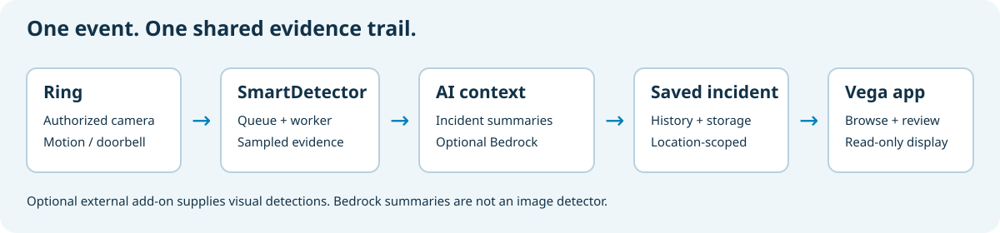

# AWS architecture — what we use and why

SmartDetector turns authorized camera events into retained evidence that can be reviewed on the web and on a paired Vega TV. AWS runs the backend; the native TV app is the viewing experience. SmartDetector’s own optional Bedrock integration summarizes incident observations. A free connector to a separately developed external detection add-on can supply additional visual features; that external project is outside this submission.

This document describes the checked-in architecture, not a claim that every optional integration is enabled in every installation. The alternatives below are design trade-offs, not comparative benchmarks or assertions that competing services cannot perform the task.

## The short version

1. Ring sends an authorized device event to the application’s HTTPS endpoint.
2. SmartDetector handles provider authentication, location ownership and evidence processing. Queued background work keeps slower enrichment and delivery separate from interactive requests.
3. SmartDetector can summarize incident observations through its own configured Bedrock integration. Additional image detection, when used, comes from a separately configured external add-on.
4. Scoped incident records and configured media storage support the website and the TV feed. The TV polls its authorized read-only feed, normally every five seconds.
5. Optional delivery channels notify the user. ADM background TV delivery is a separate path from foreground polling.

This is **serverless container infrastructure**, not an all-Lambda application. Fargate removes host management, but we still choose task CPU, memory and desired counts. Current application templates do not provision ECS target-tracking autoscaling; “serverless” does not mean an unlimited or automatically scaling worker fleet.

## Core services and decisions

| Service | What it does here | Why it fits | Alternative and trade-off |
| --- | --- | --- | --- |
| **Amazon ECS with AWS Fargate** | Runs the web console, API and long-running queue worker. | Keeps the local Docker model close to deployment and avoids managing EC2 hosts. Separate services allow different task sizing and releases. | **Lambda** is attractive for short event handlers, but would require a different execution/packaging model for the existing servers and worker. **EKS** offers more orchestration control, with additional cluster/platform complexity. **EC2** offers host control but adds patching and capacity management. |
| **Amazon DynamoDB, on-demand** | Stores organizations, users, providers, devices, incidents and scoped application state. Incident-time and device-time GSIs support feeds without full-table scans. TTL supports expiring records. | The application uses known key/query access patterns and conditional updates. On-demand avoids choosing provisioned read/write capacity for early, uneven usage. | **Aurora/RDS PostgreSQL** is stronger for relational joins and flexible SQL reporting; it would add a different schema, connection and operating model. DynamoDB requires deliberate indexes and does not replace a general-purpose analytics database. |
| **Amazon SQS + dead-letter queue** | Buffers background incident and per-display alert work and isolates failed messages for inspection. | Durable work handoff separates request latency from enrichment/delivery and gives consumers retry/visibility controls. | **Synchronous processing** couples user/webhook latency to downstream services. **Kinesis** is more appropriate when ordered streams and replay are core requirements. Standard SQS can duplicate or reorder messages: consumers must tolerate that; we do not claim exactly-once delivery. |
| **Amazon EventBridge — configurable** | A custom bus and rule route application event envelopes into SQS when enabled. The application can also send directly to SQS. | Separates event producers from routing and leaves room for additional consumers without embedding all routing in producer code. | **Direct SQS** is simpler for one work queue and is supported. **SNS** is suitable for topic fan-out, but is not the event bus selected by this pipeline. EventBridge is not a substitute for the worker queue. |
| **Amazon S3** | Provides configured evidence/object storage and publishes versioned CloudFormation/public deployment assets. Templates provision a private evidence bucket. | Object storage keeps binary assets separate from application records and container filesystems. | **EFS** fits shared POSIX filesystem needs, which this object-oriented workflow does not require. Container-local files disappear with tasks; database rows are not the right home for large original videos. A provisioned bucket is not proof that every image is stored there: the application also uses bounded inline previews in evidence records. |
| **Application Load Balancer** | Terminates/routes HTTP traffic to web/API target groups, using host/path listener rules and health checks. | Fits persistent container services and the shared AppHub ingress model. | **API Gateway** offers API-focused policy/throttling features, but would add another integration layer for these existing web and API services. **NLB** does not provide the HTTP routing selected here. |
| **Amazon VPC and security groups** | Place tasks in selected subnets and constrain service ingress. AppHub installs reuse platform networking. | Explicit network boundaries and security-group references fit private customer deployments. | Publicly exposing each container is simpler to start but loses the single controlled ingress path. VPC placement alone is not proof that tasks have no public egress; inspect the selected template/subnets. |
| **AWS IAM** | Separates task execution permissions from application task permissions; authorizes data, queue, model and configured secret access. | Workload roles avoid embedding long-lived AWS keys in the app or native package. | Static workload credentials add distribution/rotation risk. Broad administrator policies are easier during setup but are not the intended application permission model. CI publishing credentials are a separate concern from workload roles. |
| **Amazon CloudWatch Logs** | Receives container logs through the ECS logging driver. | Gives a common place to investigate API, worker and provider errors without logging into a host. | A self-managed log stack gives more control but adds an operating burden. Logs alone do not establish comprehensive alarms, tracing, dashboards or an SLO; those should not be implied. |
| **AWS CloudFormation** | Defines application resources, IAM, task definitions, service updates and optional integrations. Changes go through reviewed change sets. | Reproducible installation in SaaS and customer-owned accounts, with a visible replacement/deletion plan. | **Terraform/CDK** are valid infrastructure approaches, but direct CloudFormation aligns with this distribution/install workflow. Manual console/API resource creation would create drift and make repeatable customer installs harder. |

AWS documents the underlying behavior of [Fargate](https://docs.aws.amazon.com/AmazonECS/latest/developerguide/AWS_Fargate.html), [DynamoDB on-demand](https://docs.aws.amazon.com/amazondynamodb/latest/developerguide/on-demand-capacity-mode.html), and [standard SQS delivery](https://docs.aws.amazon.com/AWSSimpleQueueService/latest/SQSDeveloperGuide/standard-queues.html). These service properties are not application performance measurements.

## AI and computer vision

### Amazon Bedrock — SmartDetector incident summaries

SmartDetector directly calls Bedrock through the AWS SDK Converse API in `src/lib/intelligence.ts`. It sends supplied incident observations as text and requests a concise summary. Its system instructions prohibit changing alarm state, overstating readings or recommending automated physical actions. The configured model/inference profile and region come from installation settings/environment; authentication uses the AWS SDK identity. This is incident enrichment, not a claim that SmartDetector’s Bedrock call performs image detection.

**Why this choice:** managed inference with AWS authorization fits a customer-owned deployment without hosting a foundation model. It complements measured visual evidence instead of making every incident depend on a language-model response.

**Alternatives:** self-hosted models or SageMaker offer more serving/training control with additional model operations. A non-AWS inference API would introduce another credential and data-processing boundary. Rekognition addresses a different visual-detection need; it is not used by this incident-summary implementation. We have not benchmarked these alternatives here.

Bedrock summaries remain advisory. Missing enrichment is not a negative detection. [Bedrock overview](https://docs.aws.amazon.com/bedrock/latest/userguide/what-is-bedrock.html) · [SmartDetector summary implementation](../src/lib/intelligence.ts).

### Optional external detection add-on

AutoVision is separately developed and is not part of this hackathon submission. SmartDetector provides a free integration for additional visual detection features. Enabling it requires the service URL and credential; hosting, inference costs and quotas belong to that external service. Its internal models and AWS usage are not counted as SmartDetector’s hackathon implementation. Existing footage-analysis routes depend on this configured add-on and do not acquire an alternative image detector merely by enabling SmartDetector’s Bedrock summaries.

## Communication services — distinguish implementation from configuration

| Service | Role and choice | Boundaries / alternatives |
| --- | --- | --- |
| **Amazon SES** | Configured email alerts from the worker, using the application’s AWS identity and sender configuration rather than an additional email vendor. | A verified sender and suitable SES account configuration are prerequisites. SMTP or a transactional email SaaS could also work. A template parameter is not proof of successful delivery. |
| **AWS End User Messaging Social** | The notification adapter can send WhatsApp messages through configured origination details. This keeps the sending API in the AWS integration model. | Requires separate WhatsApp onboarding and permissions; normal messaging/template rules still apply. This adapter alone does not prove turnkey two-way WhatsApp. The SmartDetector application templates do not provision a complete SNS inbound WhatsApp route, so do not claim one here. Direct Meta Cloud API or another messaging provider would change onboarding/credential management, not remove it. |
| **Amazon Device Messaging (ADM)** | Registered Vega devices can receive a short-lived signed wake message; the background task fetches authorized event details and requests an actionable system popup. | ADM is an Amazon device service, not an SNS topic or SES channel. Polling works while the app is active but cannot substitute for an independent background receiver. Registration, server credentials and user opt-in are required. Cross-app popup/image behavior remains a physical-device verification item. |

Vega SDK, Ring APIs and ADM are part of the wider Amazon device ecosystem; they are not interchangeable AWS infrastructure resources. See [TV notification setup](tv-notifications.md) and [Ring developer testing](ring-developer-testing.md).

## Credentials, TLS and domain services

- **AWS Secrets Manager:** optional AutoVision API-key injection; the standard stack can create and retain an ADM credential secret and inject its JSON fields only into the worker. We chose a managed secret boundary rather than baking credentials into an image or TV package. Parameter Store is an alternative for configuration; it does not make secure injection/rotation automatic. Existing session/provider parameters have their own handling—this is not a claim that every credential has been migrated into Secrets Manager. ECS-injected secret changes require new tasks to take effect.
- **AWS KMS / managed encryption:** AWS-managed service encryption is used where configured, including the managed Secrets Manager key choice. The application templates do not establish a dedicated customer-managed KMS key architecture. Customer-managed keys would add control and policy/rotation responsibilities; do not claim them without provisioning and verifying them.
- **AWS Certificate Manager:** the templates use configured certificate ARNs with ALB HTTPS; AppHub can attach the supplied certificate. ACM fits managed TLS on the selected ingress. Domain validation and certificate ownership remain deployment prerequisites, not automatic certificate issuance by this app.
- **Amazon Route 53:** optional DNS records connect a configured hosted zone/domain to ingress. Reusing a customer’s existing DNS provider is also valid; Route 53 is not required for the native TV pairing protocol.

## Build and distribution services

- **Amazon ECR:** stores version-tagged service images consumed by ECS. Private AWS registries fit account/IAM-based container delivery; Docker Hub or GHCR could host images, but would change registry authentication and distribution setup.
- **AWS Marketplace:** the release process can submit a container delivery revision and distribute private-install templates. Marketplace is a packaging/commercial channel, not the app runtime. An image push, Marketplace approval, a CloudFormation update and a native Appstore submission are four separate operations.
- **Amazon S3 deployment assets:** the release publishes versioned templates alongside current template URLs. Versioned assets support a reproducible install/update target; they do not automatically update production.
- **GitHub Actions:** builds/tests the application and native packages. It is not an AWS service. The current workflow uses configured publisher credentials; the presence of `id-token: write` alone does not mean OIDC role assumption has been implemented. No account IDs, profile names or credentials are required in this document.

The proprietary Vega SDK builder is a build tool, not a customer application image. Its SDK terms apply; it is not published as an open-source runtime dependency.

## Optional AgentCore integration

The independent [SmartDetector AgentCore adapter](https://github.com/techcto/smartdetector-agentcore) includes MCP integration and separate runtime/publishing templates. It is not required for the SmartDetector event → TV path. The main application template does not deploy that runtime, and the v0.1.18 AgentCore release was skipped. Source availability and local checks do not establish a deployed Bedrock AgentCore invocation.

**Why separate it:** an optional tool-access integration should not add agent runtime deployment or permissions to every camera console installation. A plain HTTP tool endpoint is an alternative if managed agent-runtime integration is not required. Do not describe this as an operational agentic workflow until its deployed behavior is demonstrated.

## Deployment and local-development boundaries

| Mode | What changes |
| --- | --- |
| Hosted SaaS | Shared hosted backend with location-scoped application authorization; public signup is enabled. Logical tenancy does not imply one AWS account/table per customer. |
| Private CloudFormation | Customer-owned installation with private-install signup/billing behavior. Standalone template creates the application ECS cluster/ALB; existing/AppHub template reuses platform ingress, cluster and networking. |
| Local Compose | Containers run with DynamoDB Local, ElasticMQ and local object-storage emulation. These are not live AWS service calls. Real Bedrock, AutoVision, Ring and message delivery need explicit credentials/configuration. |

## Reliability, privacy and cost trade-offs

- **Durability is not unlimited throughput:** task capacity, queue backlog, model quotas, retries and client polling all affect end-to-end delay. Scale and measure each stage; no production p95 or unlimited-scale claim is made here.
- **Retention is enforced by the application too:** expired evidence should be inaccessible immediately. DynamoDB TTL deletion is asynchronous; backups and third-party copies have separate lifetimes. A configured S3 bucket alone does not prove a matching lifecycle policy.
- **Background delivery is best effort:** worker retries and dead-letter queues aid recovery, but do not create exactly-once notifications. Inspect failures before replaying; never blindly delete/replay a queue.
- **Idle and burst costs differ:** Fargate services, ingress and selected networking can incur standing costs. Request-based database, queue and inference use still has limits and costs. Sampling bounds analysis work; it is not evidence that a deployment is free or always cheaper than Lambda/EC2.
- **Data minimization:** short-lived read-only TV credentials, server-side provider credentials, scoped incident queries and default 24-hour evidence retention reduce exposure. They are design controls, not a blanket compliance certification.

## Encryption boundaries

The hardened templates require HTTPS between the load balancer and the web/API containers, including health checks. The application uses a native Next.js HTTPS server, not a plaintext reverse-proxy hop. Each task generates its own temporary self-signed certificate; startup key files are removed before listening. ALB encrypts target connections but does not validate target certificates, so this is not mutual TLS. Security groups restrict task ingress to the load balancer. The standalone template requires an ACM certificate and redirects port 80 to HTTPS; an existing/AppHub deployment must supply an existing HTTPS listener.

DynamoDB encryption and S3 SSE-S3 encryption are declared in both templates. Main and dead-letter SQS queues explicitly enable SQS-managed encryption. Bucket and queue policies deny non-TLS client requests, and task/execution roles deny insecure AWS API calls. Service-principal exceptions on resource policies preserve AWS service delivery. CloudWatch Logs encrypts data at rest by default; Secrets Manager encrypts secrets using its managed encryption key unless configured otherwise. Fargate services pin Linux platform 1.4.0, whose ephemeral storage is AES-256 encrypted. No additional customer-managed KMS keys are required for these controls.

Production analysis endpoints require HTTPS. Explicit local Compose development remains an HTTP-only emulation environment and does not carry the production encryption claim. These source settings do not prove an existing installation has been updated: publish the matching images, review and execute the CloudFormation change set, then verify the live configuration and application health. Do not switch targets to HTTPS while still using plaintext-only images. Target-group replacement and task rollout may briefly interrupt requests, but do not require reinstalling or replacing the database, evidence bucket or queues.

References: [ALB HTTPS targets](https://docs.aws.amazon.com/elasticloadbalancing/latest/application/load-balancer-target-groups.html), [Fargate storage encryption](https://docs.aws.amazon.com/AmazonECS/latest/developerguide/fargate-task-storage.html), [CloudWatch Logs encryption](https://docs.aws.amazon.com/AmazonCloudWatch/latest/logs/encrypt-log-data-kms.html).

## Source map

- [Standalone application template](../devops/cloudformation/smartdetector.yaml)
- [Existing/AppHub application template](../devops/cloudformation/smartdetector-existing.yaml)
- [EventBridge/direct-SQS delivery](../src/lib/event-delivery.ts)
- [DynamoDB store and query implementation](../src/lib/dynamo-store.ts)
- [Email/WhatsApp adapters](../src/lib/notifications.ts)
- [TV background registration and sender](../src/lib/tv-push.ts)
- [Container publishing workflow](../.github/workflows/release.yml)
- [Native Vega build workflow](../.github/workflows/release-vega.yml)
- [Judge walkthrough](HACKATHON-FIELD-GUIDE.md)

This is architectural documentation, not a deployment change or proof of optional service activation. Inspect the reviewed change set and actual deployment configuration before making operational claims.
