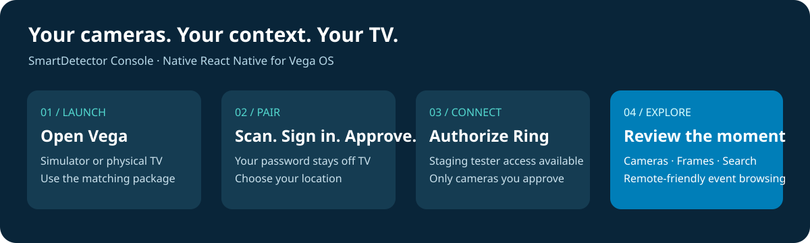
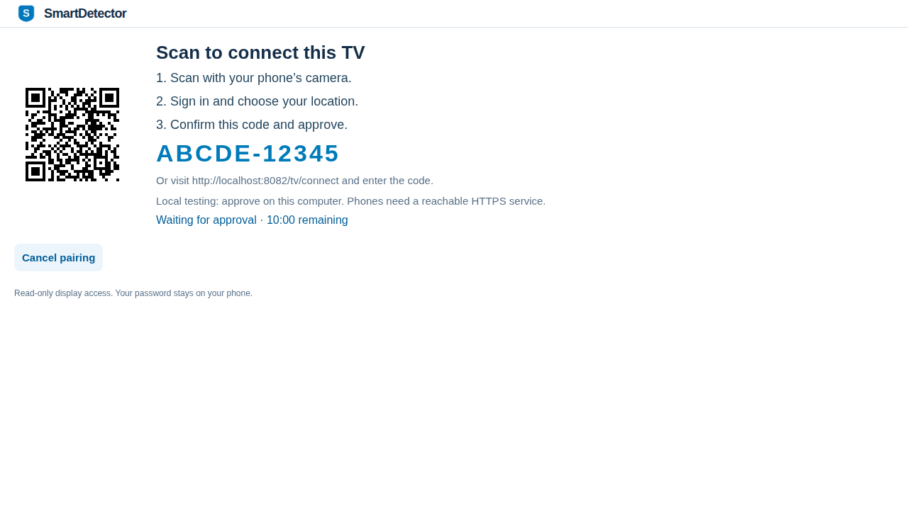
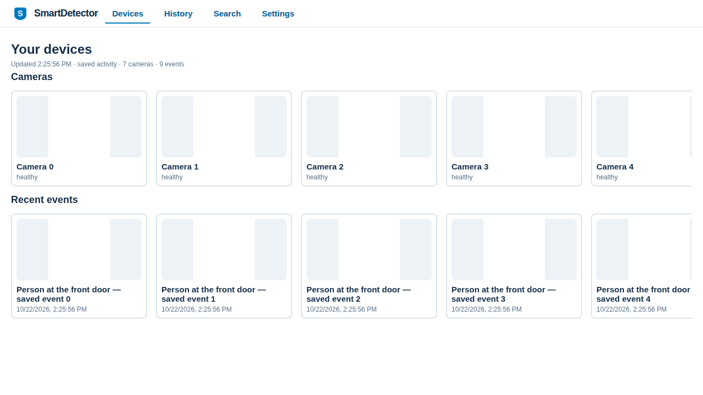
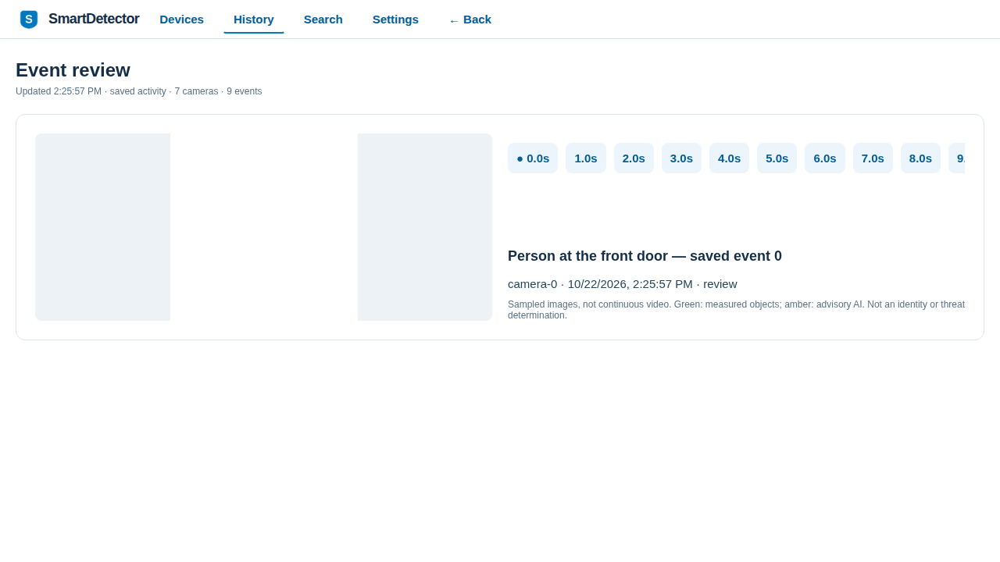
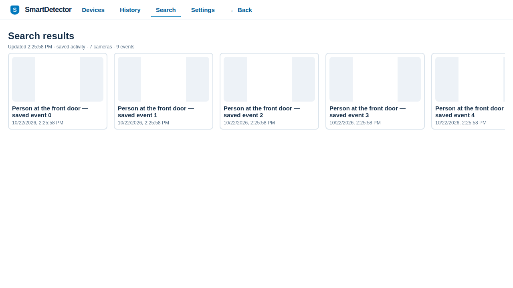

# SmartDetector on Vega — the judge’s field guide



**Start here. No AWS account, API key, or paid SmartDetector plan is needed for the hosted judge walkthrough.** Bring an Ubuntu computer with virtualization, or a supported physical Vega Fire TV. If you do not own a Ring camera, jump to [No camera?](#no-camera-use-ring-playground).

The main entry is **SmartDetector Console**, a native React Native app for **Vega OS**. Think camera collections instead of movie collections: browse with your remote, open an event, and step through its visual evidence. The website manages your account and connections; the TV is a paired, read-only display.

Quick links: [Create account](https://smartdetector.com/signup) · [Sign in](https://smartdetector.com/login) · [Pair TV](https://smartdetector.com/tv/connect) · [Source](https://github.com/techcto/smartdetector) · [Native builds](https://github.com/techcto/smartdetector/actions/workflows/release-vega.yml) · [Help](mailto:help@solodev.com)

## Take a look before you start



*Pair on your phone or computer; browse on the TV. Actual shared React UI captured in Playwright at 1280 × 720, using isolated test responses.*

[Watch the browser UI walkthrough — WebM](images/vega-playwright/1280-walkthrough.webm) · [Capture details and reproduction](images/vega-playwright/README.md)

These are browser-preview captures, not native Vega recordings. Camera names, timestamps, events and blank image fixtures are test data. They demonstrate the interface, not Ring delivery or real inference. The required hackathon video must separately show the native app on Vega hardware or its simulator.

## Step 1 — Launch the Vega simulator

### First time installing Vega?

Use native Ubuntu with an x86_64 processor, CPU virtualization enabled, and access to `/dev/kvm`. Install Git, Node.js and the **Amazon Vega SDK 0.24.12112**, including its virtual device, following [Amazon’s installation guide](https://developer.amazon.com/docs/vega/0.24/install-vega-sdk). Accept Amazon’s SDK terms. Our [Ubuntu setup guide](ubuntu-tv-development.md#1-prerequisites) includes dependency and KVM commands.

Windows/WSL is experimental: we ran it successfully, but native Ubuntu is the clearer judging path. The simulator is a separate window, not the website or browser preview.

### Build the simulator app against the hosted site

The current release workflow exports **ARMv7 for a physical TV**. Do **not** install that file in the x86_64 simulator. These commands build the correct simulator package and use the hosted service automatically because this is a **Release** build:

```bash
git clone --recurse-submodules https://github.com/techcto/smartdetector.git
cd smartdetector
source "$HOME/vega/env"
export SMARTDETECTOR_VEGA_WORK_DIR="$HOME/.cache/smartdetector-vega/judge"
npm --prefix apps/vega ci
npm --prefix apps/vega run prepare:app
cp apps/vega/native-package-lock.json "$SMARTDETECTOR_VEGA_WORK_DIR/package-lock.json"
npm --prefix "$SMARTDETECTOR_VEGA_WORK_DIR" ci
cd "$SMARTDETECTOR_VEGA_WORK_DIR"
npx react-native build-vega --build-type Release --target x86_64 --max-workers 1 --build-number 1
vega virtual-device start --timeout 120 --gl-accel
```

Leave the simulator open. In another terminal:

```bash
source "$HOME/vega/env"
vega run-app "$HOME/.cache/smartdetector-vega/judge/build/x86_64-release/smartdetectorconsole_x86_64.vpkg" com.smartdetector.console.main -d VirtualDevice
```

**You should see:** SmartDetector’s QR pairing screen. If GPU startup fails, retry the simulator with `--no-gl-accel`. A build that prints completion but never returns is not an app failure; contact us rather than waiting hours. See [troubleshooting](#if-something-doesnt-work).

### Using a real Vega Fire TV instead?

Enable developer access using [Amazon’s device instructions](https://developer.amazon.com/docs/vega/0.24/run-apps). Download the ARMv7 artifact from a **successful** native workflow run, unzip it, and install `smartdetectorconsole_armv7.vpkg` with Vega CLI. The `.vpkg` is not an Android APK. Launch component `com.smartdetector.console.main`. Amazon developer authentication is separate from your SmartDetector account.

## Step 2 — Create your free SmartDetector account

Open **[smartdetector.com/signup](https://smartdetector.com/signup)** on your computer or phone. Choose a display name, a unique username, and a password of at least 12 characters. Signup creates your personal location and makes you its administrator.

**Do not buy a SmartDetector plan for this walkthrough.** Start with the free account; plans are not part of the basic pairing walkthrough. Analysis remains subject to configured service quotas—not unlimited usage. If a limit blocks judging, email **help@solodev.com** so we can arrange reviewer access. Do not pay to get past a testing problem.

Ring’s own camera/cloud subscription requirements are separate from SmartDetector’s plans. Creating an account does not automatically add cameras or sample events.

## Step 3 — Connect the TV to your account

1. Scan the QR code displayed by the Vega app. Alternatively, open **[smartdetector.com/tv/connect](https://smartdetector.com/tv/connect)** and type the displayed code; the dash is just formatting.
2. Sign in with the account from Step 2.
3. Check the code and intended location, then explicitly approve the display.
4. Watch the TV: it checks for approval automatically and opens your camera feed. You do not enter your password or an API key on the TV.

**You should see:** the Devices screen. An empty location is normal until you connect cameras. A TV display is a viewer, not a camera, so it does not produce its own image or motion events.



*The camera library uses horizontal rails. Test fixtures shown; these are not private household cameras.*

Pairing codes last ten minutes. Get a fresh code if necessary. Display authorization is held in app memory: after restarting the app, pair again. You can revoke the display from the website’s Devices section.

## Step 4 — Test with your own Ring cameras

**The SmartDetector Ring app can be tested before public Appstore publication.** Ring allows **up to 10 staging users total**. Slots are shared, not ten per judge. [Ring’s testing instructions](https://developer.amazon.com/docs/ring/develop.html) describe the staging authorization process.

1. Email **help@solodev.com** with subject **SmartDetector hackathon — Ring tester access**. Include your SmartDetector username and the email used for your Ring account. Do not send a password, two-factor code, API key, or camera footage.
2. Wait for confirmation and the staging enrollment instructions. Email identifies your request; it does **not** grant camera access by itself. You must personally complete Ring’s sign-in and consent flow. We never need your Ring password.
3. Use Ring’s staging flow to find **SmartDetector**, select the location and cameras you want to share, and approve access. Follow Ring’s redirect to SmartDetector, sign in, and confirm the correct SmartDetector location.
4. In SmartDetector, open **Devices → Ring → Connect provider**, check the connection, and **Sync shared cameras**.
5. Return to the paired Vega app. Cameras appear as the feed refreshes, normally on a five-second polling interval.

Ring currently documents US-located test devices and an active Ring Protection plan for cloud features; staging users do not purchase the partner app to test it. Available media still depends on device capabilities and permissions. Ask us if you cannot see the staging app rather than purchasing anything.

**This links your cameras, not the developer’s house.** We do not distribute household accounts, camera credentials, or someone else’s private footage.

## Step 5 — Trigger a moment, then review it on TV

1. Walk in view of an authorized camera with motion enabled, or press its doorbell. Use only a location you are allowed to test.
2. Open SmartDetector’s **History** on the website. Find the new camera event. Media retrieval and analysis are asynchronous; Ring’s own notification may arrive earlier.
3. On Vega, use **Left/Right** to browse a camera rail and **Up/Down** to move between rows. Select the camera, then the event.
4. Step through sampled frames. Inspect available detection boxes and analysis. Try **Search** using a description in an existing event, such as “person”.
5. Use **Back** to return from event → camera → Devices. Try History, Search and Settings as well.

**Success:** the same camera event and retained evidence are visible on the website and the paired TV. Opening live view alone is not a motion event. Empty results mean no matching retained evidence—not proof that nothing happened.



*Review sampled frames and available evidence. This UI capture uses blank test images and does not represent analyzed footage.*



*Search existing retained evidence, then select a result to review it. Search results shown are isolated fixtures.*

## What to look for in the Vega app

| Feature | Try it |
| --- | --- |
| QR pairing | Approve a short-lived code on a phone; the TV opens automatically. |
| Remote-first navigation | Browse camera/activity rails, move between rows, and use hierarchical Back. |
| Location-scoped access | Pair to the intended location; the TV receives a read-only feed. |
| Evidence review | Open a camera’s history, step through retained frames, and inspect available boxes. |
| Saved-event search | Search structured retained evidence; this is not continuous-video indexing. |
| Foreground alerts | Keep SmartDetector open while a new eligible incident arrives. |
| Privacy controls | Use website Settings to purge history, manage retention, or delete the account. |

Search supports the system keyboard. Direct remote microphone capture is not implemented; dictation depends on the device keyboard. Native Ring live playback is not implemented; live-view links use the web console. The browser preview shares UI code but is **not** a Vega simulator or the submitted native app.

**Background notifications:** ADM sender/receiver and an actionable system popup are implemented in the RN 0.72 app. Credentials, deployment, opt-in and physical-TV verification are required. Cross-app delivery and popup images are not yet demonstrated; do not make a movie-overlay test part of the required walkthrough until verified. See [notification setup](tv-notifications.md).

## No camera? Use Ring Playground

This is the hardware-free developer path. It uses **the local backend**, not your new hosted account. Follow [Ubuntu local development](ubuntu-tv-development.md) for the full copy-and-paste startup, Debug simulator build and port forwarding.

1. Clone this repository, copy `.env.example` to `.env` only if it does not exist, and run `bash app.sh up`.
2. Open **http://localhost:8082**. Use local-only `root` / `smartdetector-local-change-me` unless you changed the ignored environment file. Never try these credentials on production.
3. Create an [Amazon Developer account](https://developer.amazon.com/), open the [Ring Developer Console](https://developer.amazon.com/ring/console), choose **Playground**, and generate a temporary token.
4. In local SmartDetector, open **Devices → Ring → Connect provider → Developer testing · Ring Playground**. Paste the token there and connect test cameras. Never paste it into chat, Git, or a screenshot.
5. Open the discovered camera’s live view and use **Analyze Playground footage**. The action samples eight frames over seven seconds and uses the normal analysis/history/TV pipeline. Working AutoVision credentials must be configured by the local administrator for real inference; merely starting Docker does not configure them.
6. Pair the **Debug** Vega app to this local location at **http://localhost:8082/tv/connect**. Open that address on the development computer, not a phone: a phone’s localhost is the phone itself.

The token expires after at most 30 minutes; paste a fresh token to continue. Matching device IDs retain their local history. This option is restricted to local root development and does not appear in hosted SaaS or production private installations.

Ring Playground provides sample live streams. Its Package/Vehicle/Motion buttons do **not** deliver production motion webhooks to SmartDetector. Manual footage analysis shares the processing pipeline but is labeled `ring-playground`; it is not claimed as a real motion delivery test. [Detailed Playground guide](ring-developer-testing.md).

## Behind the scenes: the TV is the experience; AWS is the engine

Read the [AWS architecture and service choices](AWS-ARCHITECTURE.md) for the full service inventory and alternatives.


**Ring event → SmartDetector processing and incident history → paired Vega display.**

Configured Bedrock enrichment adds incident summaries. Additional visual detection uses a separately configured external add-on.

SmartDetector’s hosted website at **smartdetector.com** handles accounts, locations, Ring consent, devices, incident history and privacy.

- **Amazon Bedrock**, when configured in SmartDetector, summarizes supplied incident observations. It does not independently establish what is present in an image.
- **Optional external detection add-on:** AutoVision can supply additional visual detections. It is separately developed, outside this hackathon submission, and the integration is free to add. External service usage limits and hosting/inference costs remain separate. Camera-analysis steps that invoke it require a configured service.
- **SQS and workers** decouple event ingestion from analysis and notification work. **DynamoDB** stores scoped records, with indexed incident retrieval; **S3** holds configured object storage. **ECS/Fargate** runs the application services. Deployment is managed through **CloudFormation**.
- **ADM** is the implemented optional background TV delivery path; configured **SES** supports email. Do not assume optional delivery integrations are enabled just because the app is installed.

The TV does not run Bedrock locally. Detector labels are not identity or intent, and this project is not a certified emergency alarm. Review the actual evidence rather than treating an AI summary as fact. See the [AWS architecture](AWS-ARCHITECTURE.md).

## Your data and your cameras stay yours

Default saved-event/image retention is **24 hours**. This is still data storage, not “no data collected.” Account records, provider connections and optional face references have separate lifetimes. Paid administrators may explicitly choose longer retention; subscribing alone does not extend it.

[Privacy policy](https://smartdetector.com/privacy) · [Purge saved data](https://smartdetector.com/settings/data-deletion) · [Delete account](https://smartdetector.com/settings/account-deletion). Deletion actions require sign-in. Purging history preserves the account; deleting the account is a separate operation. These controls do not delete Ring’s recordings or third-party copies.

## If something doesn’t work

| What you see | What to do |
| --- | --- |
| No cameras after signup | Connect and sync an authorized Ring location; signup does not seed footage. |
| SmartDetector absent in Ring | Ask us to arrange staging access; do not pay for a plan to fix enrollment. |
| Pairing code expired | Generate a fresh code, check location, and approve again. |
| Simulator rejects the package | Use x86_64 for the documented Ubuntu simulator; ARMv7 is for the physical TV. |
| Black Playground video | Check token expiry and media connectivity. A successful WHEP response alone does not prove playback. |
| No event after opening a stream | Live view is not a webhook; trigger real motion or use the explicit local analysis action. |
| Local analysis fails | Check AutoVision configuration/quota; no synthetic result is inserted on failure. |
| No popup over another app | Background delivery has separate prerequisites and remains a physical verification gate. |
| Native build never exits | Report the run URL and final log lines. Packaging jobs have a 30-minute cap; rerunning old tags does not pick up later fixes. |

Contact **help@solodev.com** with the step, app/build version, approximate time and a sanitized error. Never send credentials, tokens, camera IDs or private footage. Keep any private reviewer credentials in the submission’s private testing instructions, not this public repository.


